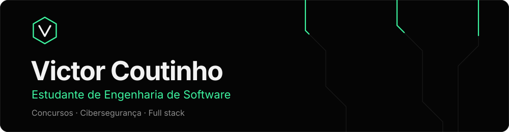
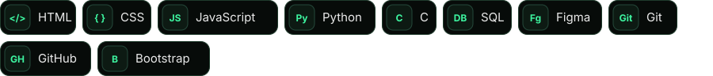

 

[**Portfólio**](https://victor-coutin.github.io/portfolio/) · [LinkedIn](https://www.linkedin.com/in/victor-coutinho-3b630a3b6) · [Instagram](https://www.instagram.com/victor.coutin/) · [Currículo](https://victor-coutin.github.io/portfolio/curriculo-victor-coutinho.pdf)

## Sobre mim

Sou estudante de Engenharia de Software no UDF e transformo cada matéria em projeto. Meu foco principal hoje são os **concursos públicos**, e em paralelo estudo **cibersegurança** e **desenvolvimento full stack**.

## O que estou estudando

- Linguagem C e algoritmos
- HTML, CSS e JavaScript no front-end
- SQL e modelagem de banco de dados
- Design de interfaces e jornada do usuário
- Git e GitHub no dia a dia

## Stack

## Projetos

- **ReservEI**: sistema de reservas e mesas de restaurante, com protótipo no Figma e banco de dados em MySQL.
- **[Direitos TEA](https://tea-profissional.netlify.app/)**: aplicativo web com os direitos de pessoas com TEA em linguagem simples.
- **[HoyalPet](https://github.com/Victor-Coutin/HoyalPet)**: site de um pet shop fictício, feito com HTML e CSS.
- **Presidentes do Brasil** e **12 de Outubro**: sites feitos nos estudos de HTML, CSS e JavaScript.

Todos eles estão no meu [portfólio](https://victor-coutin.github.io/portfolio/).

## Minhas contribuições

<picture>
  <source media="(prefers-color-scheme: dark)" srcset="https://raw.githubusercontent.com/Victor-Coutin/Victor-Coutin/output/github-snake-dark.svg" />
  <source media="(prefers-color-scheme: light)" srcset="https://raw.githubusercontent.com/Victor-Coutin/Victor-Coutin/output/github-snake.svg" />
  
</picture>
